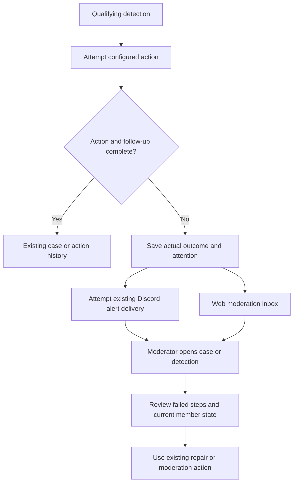

# Automatic moderation without a blanket setup gate

## Review brief

Drasil should attempt the configured moderation response when a detection qualifies, even when the server's general setup checklist has errors. Keep safeguards specific to the operation. Preserve successful actions and make failures visible to moderators through the existing case, alert, and inbox paths.

This fixes a demonstrated failure where a high-confidence detection requested restriction but was silently downgraded to `record_only` because the case role had extra verification-channel media and reaction permissions.

The user has selected removal of the blanket readiness gate, including for automatic kicks. The user approved this design on 2026-11-11. No product code, live settings, or Discord permissions have changed.

The tradeoff is deliberate: Drasil may provide incomplete restriction while moderators repair configuration. It must describe what actually happened, rather than implying complete isolation. It must not replace a configured restriction with a kick unless the existing automatic-kick policy independently selects that action.

## Confirmed decisions and approaches

| Approach                                                      | Tradeoff                                                                                              | Decision                                                      |
| ------------------------------------------------------------- | ----------------------------------------------------------------------------------------------------- | ------------------------------------------------------------- |
| Remove the blanket gate; report actual action outcomes        | Uses the real operation as the authority. Partial outcomes need durable records and clear copy.       | Selected by the user.                                         |
| Replace the blanket gate with readiness gates for each action | Can avoid some failed calls, but duplicates permission logic and risks recreating unrelated blockers. | Rejected. Retain only existing operation-specific safeguards. |

Keep configured `off`, `record_only`, and `notify_only`, existing confidence thresholds, staff exemptions, automatic-kick opt-ins, target protections, and action-specific authorization. General readiness no longer changes the requested response mode at runtime.

Role assignment must still prevent privilege escalation. Preserve the existing requirement that the case role grants no guild permissions, including Administrator, but enforce it at the shared assignment boundary before adding the role. Reject @everyone, managed/unassignable roles, and channel overwrites that grant administrative or moderation capabilities. These are safeguards for the specific role grant, not a general setup-readiness check. Ordinary media/reaction allows in the designated verification area do not by themselves block assignment. Known incomplete channel isolation is reported as a limitation; it does not justify silently skipping the entire response. Check the candidate role before role-quarantine side effects where possible, and preserve existing quarantine rollback behavior when assignment fails.

Setup diagnostics and onboarding remain available for configuration guidance. Changing their readiness rules, permission allowances, or onboarding gates is deferred. A diagnostic error is not by itself proof that a particular moderation operation cannot work.

## Moderator experience

A qualifying detection follows its configured policy. A case appears even if its role or thread fails. Its existing notification and web detail identify the incomplete steps and link to the case. Known access limitations remain visible; applying a role must not be described as verified full isolation.

When no case exists, a failed automatic action creates an actionable observed alert tied to the detection. An existing case absorbs the failure instead of creating a second case or duplicate attention item. An already successful kick is shown as successful even when bookkeeping or notification delivery later fails.

Example messages describe concrete outcomes:

- "Restriction incomplete. Case role could not be applied. Moderator action required."
- "Case role applied. Case thread could not be created. Moderator action required."
- "Automatic kick failed. The member may still have access."
- "Member kicked. Notification delivery failed."
- "Kick outcome could not be confirmed. Check membership before taking further action."

Failures are visible in the existing web moderation inbox even if Discord notification delivery is unavailable. Persist attention before attempting Discord delivery; an alert's existence must not depend on a successful send or a configured Discord queue channel. Reuse existing queue items and metadata rather than introducing a separate failure dashboard.

### How does a moderator reach an incomplete response?

Today, a general setup error instead stops the action and observed alert, leaving a recorded detection plus a separately deduplicated setup DM. The proposed flow removes that branch.

## Action and failure rules

| Situation                                                           | Required behavior                                                                                                                                               |
| ------------------------------------------------------------------- | --------------------------------------------------------------------------------------------------------------------------------------------------------------- |
| General setup error or diagnostic service unavailable               | Do not gate restriction, notification, or an otherwise eligible automatic kick.                                                                                 |
| Role application fails                                              | Keep the durable case, record the role failure, and continue independent thread and notification steps as the existing case flow permits.                       |
| Role applied but thread or notification fails                       | Preserve role and case state. Mark the failed steps and request moderator attention.                                                                            |
| Automatic kick selected                                             | Attempt the kick through the existing moderation service. Role or thread setup is not a prerequisite.                                                           |
| Kick rejected before Discord success                                | Persist the failed attempt and alert moderators. Do not silently select another enforcement action.                                                             |
| Kick acknowledged, later work fails                                 | Preserve the acknowledged kick result separately from bookkeeping or delivery failure. Never report the whole operation as an unperformed kick.                 |
| Discord result uncertain                                            | Record an unknown outcome and request inspection. Do not automatically retry or claim success/failure without evidence.                                         |
| Discord alert delivery fails                                        | Keep the durable inbox item, record delivery failure, and emit error telemetry. Do not send evidence to a public or arbitrary fallback channel.                 |
| Detection or outcome persistence fails                              | Emit error telemetry with safe identifiers. Stop dependent enforcement when its durable record is a required precondition. Do not claim a durable alert exists. |
| Explicit `record_only`, `off`, exemption, or below-threshold policy | Preserve the existing policy. Do not convert deliberate silence into a failure alert.                                                                           |

An operational failure after a selected enforcement action requires attention even if the ordinary observed-alert confidence threshold is higher. The action already qualified under its own policy. Normal low-confidence notification routing remains unchanged.

Successful steps are not rolled back to make the outcome look atomic. Continue only independent work; retain validation, authorization, evidence requirements, and sequencing that prevent unsafe side effects. No automatic retries, new escalation to kicks, or automatic repair of channel permissions are introduced.

## Persistence, notifications, and telemetry

Reuse verification action-failure metadata for case steps. Extend existing detection and queue metadata only where there is no case. The smallest implementation should retain the selected action, confirmed action outcome, failed follow-up steps, safe reason codes, timestamps, and links to the owning case/detection. Reuse existing durable action records for confirmed success rather than maintaining contradictory status fields.

The existing boolean kick result cannot distinguish a rejected kick from a confirmed kick followed by failed updates. The implementation must preserve that distinction at the Discord acknowledgement boundary and update affected shared callers. The exact internal result type belongs to implementation planning; no public API or database enum change is assumed.

Use the existing attention lifecycle and deduplication by case/detection. Initial alert delivery must not be suppressed by setup-DM cooldowns. Existing alert update behavior may coalesce repeated failures, but must preserve changed or unresolved failure details. A moderator can use existing repair/actions and attention controls; refresh the displayed state from current durable records. Acknowledging attention does not mean that restriction succeeded.

Incomplete actions are warning/error outcomes in traces and logs, with requested action, actual confirmed outcome, failed step, and case/detection identifiers. Delivery and persistence failures are errors. Explicit `record_only` remains an ordinary policy outcome. Do not log raw messages, prompts, credentials, or private community names.

Setup DMs may remain supplemental guidance. Remove the obsolete readiness cache and downgrade machinery when no longer used. Keep shared setup-nudge code required by onboarding. No new background health monitor or reminder schedule is part of this change.

## Engineering scope and verification

The change reaches `EventHandler` automatic message/join routing, rejoin paths that share that routing, and the staff/watchlist observed-alert path. Check every caller of the removed readiness helper so none retains the silent downgrade.

Reuse `SecurityActionService`, `UserModerationService`, `RoleManager`, `NotificationManager`, `ModerationQueueService`, and existing case failure utilities. Inspect every shared role-assignment caller, including repair and rollback paths, so the safety check cannot be bypassed and a rejected grant is surfaced truthfully. Shared kick handling also serves report-intake and manual actions; preserve their authorization and existing policy while retaining truthful post-kick outcomes. Update inbox/detail adapters, Discord payloads, and their fixtures only where needed to display the new failure state. Keep existing behavior for successful actions.

No new dependency, general workflow framework, or schema migration is proposed. If implementation discovers a migration is necessary, bring that change back for review before expanding scope.

Acceptance checks cover:

1. Setup errors and unavailable diagnostics do not prevent qualified message/join restriction, observed alerts, staff watchlist review, or eligible kicks.
2. Explicit response modes, thresholds, exemptions, and kick opt-ins still control routing.
3. Role, thread, and notification failures preserve successful case steps and produce one actionable attention item.
4. Failed kicks and confirmed kicks with failed follow-up remain distinct across shared callers; uncertain results are not retried automatically.
5. Missing/inaccessible Discord delivery leaves a durable web inbox item without routing evidence elsewhere.
6. Failure alerts are not lost to setup-DM cooldowns or ordinary observed-alert thresholds.
7. Duplicate processing reuses existing case/detection attention and does not replay a confirmed kick.
8. A role with guild permissions or administrative/moderation channel grants is never added, including through shared repair paths. Benign verification-channel media/reaction grants do not trigger the old blanket downgrade.
9. Focused service, adapter, and payload tests verify real outcomes. Run repository-required CI checks during implementation. Any changed web layout receives the existing UI verification.

The moderator journey uses existing inbox, case, and detection pages. No new navigation or authentication flow is proposed, so external UX journey research is unnecessary for this design.

## Deferred work and risks

The existing lockdown warnings and extra permission grants still need a separate audit. Removing this gate does not prove full isolation or repair them. No historical detections are replayed and no production permissions are changed by this design.

A total database outage can prevent durable attention. A Discord outage can prevent immediate Discord alerts. The design makes those limits explicit through the remaining available records and telemetry; it cannot guarantee delivery through an unavailable system.

## Evidence appendix

- Design baseline: `18fce32b09063f020deeafe1768a69924bed6834`, refreshed `origin/main` on 2026-11-11. Incident deployment: `a546587dd461233ff5ea37c631bbbe3b59bf26a3`.
- Historical Executor trace read confirmed `requested_mode: restrict`, `effective_mode: record_only`, and suspicious classifier results. Outcome observations used `DEFAULT` level.
- Stored configuration selected `restrict` without message/join overrides. The saved setup warning code was `case-role-channel-overwrites`.
- Setup warnings use a seven-day recipient/fingerprint cooldown. The saved November 5 attempt was inside that window for the November 11 incident. A recorded send does not establish that the recipient read it.
- The read-only Executor lockdown audit completed with zero errors, 448 warnings, five proposed writes, and zero applied writes. Those warnings were not individually classified.
- Current permission inspection showed the affected restricted member could not view or send in the checked general-chat channel. This is one member/channel observation, not proof of complete isolation.
- Source references: `src/controllers/EventHandler.ts`, `src/services/SetupDiagnosticsService.ts`, `src/utils/verificationChannelPermissions.ts`, `src/services/SecurityActionService.ts`, `src/services/UserModerationService.ts`, `src/services/ModerationQueueService.ts`, `src/services/RoleManager.ts`, `apps/web/lib/moderationInboxDataAdapter.ts`.
