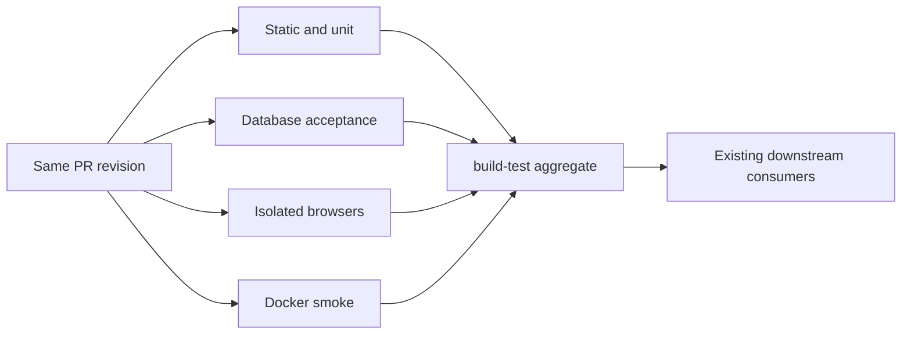

# Faster CI with the existing checks

## Review brief

Deliver one PR that removes repeated setup and then runs independent checks concurrently. Developers should get a complete CI result near 10 minutes instead of the measured 22-25 minutes, while every existing check still runs. The target is an estimate, not an acceptance claim.

The user accepts a modest increase in runner usage and chose to deliver cleanup and parallelization together. Implement the cleanup first, measure it, then add the job split in the same PR. This document proposes the job boundaries, validation and cost limits for approval. Implementation has not started.

The main tradeoff is repeated dependency installation across jobs. Use four execution jobs, including the existing Docker smoke check, rather than spreading every suite across its own runner. The database job is likely to remain the longest.

## Decisions and alternatives

| Approach                                      | Benefit                                                   | Tradeoff                           | Status                   |
| --------------------------------------------- | --------------------------------------------------------- | ---------------------------------- | ------------------------ |
| Cleanup followed by parallelization in one PR | One review and delivery, with separate measurement points | Larger change to review and revert | Selected by the user     |
| Cleanup and parallelization in separate PRs   | Separate rollout and rollback for each stage              | Two review cycles                  | Considered, not selected |

Confirmed requirements:

- Reduce wasted work before introducing concurrency.
- Keep existing test cases, assertions, coverage thresholds, screenshots, security checks and production packaging checks.
- Accept a modest increase in total runner minutes for materially faster completion.
- Retain the existing required `build-test` status and keep deployment dependent on the complete CI result wherever that dependency exists today.

Proposed engineering choices:

- Four execution jobs and one small aggregate gate, with no cross-job build artifact transport.
- A separate disposable Postgres service only for the database job.
- Keep database consumers sequential and retain one worker for their browser suites.
- Start Storybook at its existing worker count. Benchmark two workers only after the job split is measured.
- No dependency additions or general-purpose task scheduler.

## Developer experience

A PR shows named groups for static/unit checks, database acceptance, isolated browser checks and Docker smoke. A failure identifies the affected group and command without opening a single long quality-gate step. `build-test` succeeds only when every execution group succeeds.

`npm run check:ci` remains the complete local entry point. It runs the same groups sequentially against the owned local database, avoiding concurrent local database consumers. Standalone build, test and integration commands keep preparing their prerequisites when invoked directly.

## Where elapsed time goes today

Three successful hosted runs show the same serial structure:

| Work                                    | Observed elapsed time |
| --------------------------------------- | --------------------- |
| Storybook, 167 tests through one worker | About 4.5-5.3 minutes |
| Bot Postgres integration, 32 suites     | About 3.8-4.3 minutes |
| Other browser suites combined           | About 5-6 minutes     |
| Production Docker smoke                 | About 2 minutes       |
| Installation and job setup              | About 2 minutes       |
| Bot unit tests                          | 53-61 seconds         |
| Other checks and builds                 | About 4 minutes       |

The quality-gate logs contain nine application builds and 32 migration CLI checks from integration suite setup. These observations identify wasted work; they do not establish the exact savings from removing it.

## Stage 1: remove repeated work

### Build prerequisites once

Use the existing npm scripts and tools. Make CI group commands consume outputs produced by an explicit bootstrap. Within each execution job, build `@drasil/application` once before its consumers. Build the bot once in jobs that require its compiled output. Build the production web app once in the database job before production workspace acceptance.

Avoid lifecycle-hook rebuilds inside the prepared CI sequence. Keep the current prerequisite behavior for standalone developer commands. Scope any lifecycle suppression to commands after successful explicit preparation, never to dependency installation. Do not add timestamp caches, stale-output detection or persistent prebuilt flags.

For MCP acceptance, use the already compiled bot output instead of repeating the explicit root build embedded in `web:e2e:mcp`. Preserve the owned-database guard and all MCP environment configuration in `run-mcp-e2e.js`.

### Prepare integration storage once

Move extension creation and migration deployment out of per-suite `setupFilesAfterEnv`. Prepare storage at run orchestration before the first database consumer. A direct `npm run test:integration` must still prepare its database before launching Jest.

The CI database sequence owns one preparation and then invokes prepared consumers. Reuse the existing `prepare-test-database.js` implementation. Choose the smallest explicit command structure during implementation; do not introduce an unchecked environment flag that lets arbitrary callers bypass preparation.

Keep per-test truncation and per-suite connection cleanup. The owned-target validation must still run before migrations, connection pools and destructive fixtures. Keep all three database URLs identical and retain the current accepted loopback targets. Do not raise Jest database workers or change database durability settings.

Prisma client generation remains a prerequisite. Audit generation calls, but only remove a duplicate when clean-checkout and standalone paths prove the generated client is available. Do not broaden the Prisma postinstall behavior in this changeset.

## Stage 2: run independent groups concurrently

All execution jobs start from the same checkout revision and use Node 24 on Ubuntu 24.04. Use existing npm dependency caching. Each job owns its working directory and generated files. Install Chromium only where browser tests run. The Docker job uses its existing Dockerfile installation and build path.

| Job                 | Commands and responsibilities                                                                                                                                                                                                                                          |
| ------------------- | ---------------------------------------------------------------------------------------------------------------------------------------------------------------------------------------------------------------------------------------------------------------------- |
| Static and unit     | Format; application build, lint, typecheck and coverage; action-boundary checks; root lint and bot build/unit tests; contracts lint, typecheck and coverage; web lint and typecheck                                                                                    |
| Database acceptance | Application and bot bootstrap; database guard tests and preparation; web coverage; production web build; packaging and production graph checks; production workspace browser suite; bot integration; web integration; enabled MCP browser acceptance; final RLS checks |
| Isolated browsers   | Application bootstrap; Storybook production build; legacy fixture browser suite; legacy visual suite; Storybook browser/visual suite                                                                                                                                   |
| Docker smoke        | Existing production image build and application import smoke check                                                                                                                                                                                                     |

Web coverage stays in the database job because its persisted rate-limit tests use the supplied test database. Production workspace and enabled MCP acceptance also stay there. Their fixtures truncate or mutate shared storage, so those commands run sequentially.

The isolated browser job uses legacy fixture mode and Storybook mocks. Do not supply database URLs to this job. Preserve the current disabled MCP cases in the legacy invocation and run enabled MCP cases in the database job. Verify this boundary with a full hosted run, including a check that no suite silently skips due to missing configuration.

Production web acceptance must continue using its production build. Legacy fixture acceptance must retain its separate dev-server/build configuration. Do not combine the two servers or reuse one mode's output for the other.

### What does the final gate wait for?

The aggregate uses `always()` so it reports a terminal failure when a prerequisite fails or is skipped. It explicitly requires all four prerequisite results to equal `success`. Failure, cancellation or skipping must never produce a successful aggregate. Keep the exact `build-test` check name.

Metrics remains a separate check. Preserve snapshot preview behavior, failure screenshot logging and Playwright artifact collection. Give browser jobs distinct artifact names to avoid upload collisions.

The web deployment job keeps its existing `build-test` and metrics prerequisites and its existing environment gate. The bot production workflow currently runs independently on pushes to main; this changeset does not redesign deployment policy or invoke either deployment.

## Measurement and acceptance

Publish a short timing comparison for the serial baseline, cleanup-only revision and final revision. Report both end-to-end check completion and the sum of execution-job durations. Identify runner queue time separately from execution time where available. Compare successful runs, not early failures.

Aim for 10-12 minutes to the final gate, excluding queue delays and separate production deployment. Investigate a result above 12 minutes before claiming the speedup is complete. A slower result is evidence for revisiting the split, not permission to drop checks.

Treat an increase above 25 percent in summed execution-job minutes as exceeding the proposed modest-cost budget. Report that result and revise the split or seek the user's judgment before accepting it. The user approved modest growth, not this exact numeric threshold; 25 percent is a proposed conservative review trigger.

Before declaring the PR ready:

- Map every command in the original `check:ci` and Docker smoke to a final group. Run each once, retaining coverage and snapshot assertions.
- Verify clean-checkout bootstrap and standalone build/unit/integration commands still work.
- Check migration preparation happens once per database sequence, with truncation still happening between tests.
- Exercise aggregate success and failure/skip/cancel result handling with a focused assertion-based check, and lint the workflow.
- Run a complete hosted PR CI at the final head and inspect test counts, intended skips and artifacts.
- Complete the existing delayed CI/review feedback sweep for the exact pushed head. Do not merge or deploy as part of this task.

Use two Storybook workers only if a comparative run shows worthwhile improvement, unchanged test execution and screenshots, and no observed instability. Otherwise keep one worker. This is a bounded experiment, not a requirement for the initial split.

## Expected scope and deferred work

Expected files include `.github/workflows/ci.yml`, root and web npm scripts where necessary, the integration runner and Jest setup, `testDb.ts`, narrowly scoped verification tests, and the developer docs that describe `check:ci` and database preparation. Update `AGENTS.md` only where its current CI/testing description becomes inaccurate. The implementation plan will resolve the exact inventory.

No application behavior, database schema, dependency versions, review policy, coverage thresholds or snapshot baselines change. Defer path-based check skipping, test sharding, remote build caches, browser-server rewrites, static Storybook serving and runner upgrades until measurements justify them.

Rollback is the prior serial workflow and script orchestration. Keep cleanup and parallelization in separate commits so the latter can be reverted independently if it introduces interference.

## Evidence appendix

- Source baseline: `927cbd7d1ab077c59de0cd358aa0fae1f30bb7da`.
- [CI run 43321097270](https://github.com/BITRATE-Labs/drasil/actions/runs/43321097270), bot units 60.94 seconds, Storybook 5.3 minutes, bot integration 231.362 seconds.
- [CI run 43332105653](https://github.com/BITRATE-Labs/drasil/actions/runs/43332105653), bot units 56.678 seconds, Storybook 4.5 minutes, bot integration 259.094 seconds.
- [CI run 43333375905](https://github.com/BITRATE-Labs/drasil/actions/runs/43333375905), build-test execution 22 minutes 29 seconds, bot units 53.389 seconds, Storybook 4.6 minutes, bot integration 228.257 seconds.
- The latter two runs include newer PR changes than the source baseline. The relevant workflow and orchestration configuration matches the inspected main baseline; their timing variation is historical evidence, not a controlled benchmark.
- Source references: [workflow](../../../.github/workflows/ci.yml), [root scripts](../../../package.json), [integration setup](../../../src/__tests__/setup.ts), [database helper](../../../src/__tests__/testDb.ts), [database preparation](../../../scripts/prepare-test-database.js), [web coverage config](../../../apps/web/vitest.config.ts).
