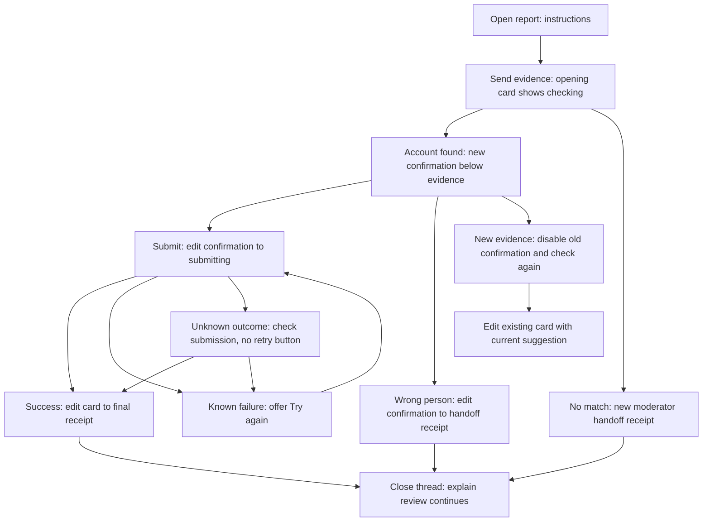

# Report thread presentation design

## Outcome and scope

Keep a report readable without hiding the moment when the reporter needs to act. Use an opening card for instructions and initial checking, then a second message for confirmation or moderator handoff. Edit that second message into the final receipt.

The user approved this flow and its failure/close states in the interactive mockup. This document records that design for implementation. Model selection, identity matching, moderation policy, evidence retention, and the staff review experience are unchanged.

## Reporter journey

Two bot messages is the normal-flow target, not a license to delete evidence or conceal a delivery failure. Discord edits do not move a message. Evidence sent after the confirmation remains below it. Do not delete and repost for each update.

## Copy and controls

| State                           | Title and body                                                                                                                                                           | Reporter controls                            |
| ------------------------------- | ------------------------------------------------------------------------------------------------------------------------------------------------------------------------ | -------------------------------------------- |
| Start                           | **Tell us what happened**. Add a screenshot, message link, or the person's name.                                                                                         | Close report                                 |
| Initial checking                | **Checking your report**. Looking for the account in your report.                                                                                                        | Close report                                 |
| Confirmation                    | **Is this the right person?** Name, username, avatar, and server nickname only when different. For a screenshot-backed suggestion: This name appears in your screenshot. | Submit report; Not this person; Close report |
| New evidence                    | **Checking the new details**. Your new evidence may change the suggested account.                                                                                        | None until the current result is ready       |
| Submitting                      | **Submitting your report**. This should only take a moment.                                                                                                              | None                                         |
| Known failure                   | **Your report wasn't submitted**. Your evidence is still here. Try submitting again.                                                                                     | Try again; Close report                      |
| Unknown outcome                 | **Checking submission**. We're checking whether your report went through. Your evidence is still here.                                                                   | None                                         |
| Submitted                       | **Report submitted**. Moderators have your report about **{name}**. You don't need to do anything else.                                                                  | Close thread                                 |
| Moderator handoff               | **Sent to moderators**. A moderator will take a look. You don't need to do anything else. Supporting text: Have more to add? Send it here.                               | Close thread                                 |
| Close unfinished report         | **Close this report?** You won't be able to add more in this thread.                                                                                                     | Keep open; Close report                      |
| Close after handoff/submission  | **Close this thread?** Moderators will still review your report. You won't be able to add more in this thread.                                                           | Keep open; Close thread                      |
| Closed unfinished report        | **Thread closed**. You can no longer add to this thread.                                                                                                                 | None                                         |
| Closed after handoff/submission | **Thread closed**. Moderators still have your report.                                                                                                                    | None                                         |

Keep open restores the latest durable state, not a captured stale suggestion. Close confirmation is temporary presentation, not a new report status. Only show closed after the thread operation succeeds. If closing fails, retain the open state and use a short private error: "Couldn't close the thread. Try again."

Do not claim a screenshot match for text-only evidence. Omit the optional explanation unless its source supports it. Escape names and disable incidental mentions. Missing avatars/nicknames are omitted.

## Delivery and ownership

- Initial card stops showing progress and loses obsolete controls when the follow-up takes over. Evidence is never moved or rewritten.
- No separate Evidence saved message, visible GUID, technical match fields, duplicate submission reply, or late handoff receipt after successful submission.
- First confirmation may use one targeted reporter mention. Proposed implementation uses it on the first confirmation only, with an explicit allowed-user list. Edits, replacements and recovery do not ping again. Actual notifications depend on Discord settings.
- Existing Admin actions access remains available and permission-checked. The mockup's staff toggle is a demonstration control, not a promise Discord can hide a shared button per viewer.
- Wrong or missing identity routes to existing moderator review. A submitted or handed-off report never returns to reporter confirmation because more evidence arrived.
- Only say Sent to moderators after successful staff delivery. While handoff delivery is pending, keep a neutral checking state and use existing recovery/attention mechanisms. Evidence remains saved.
- A known failure means dispatch definitely did not happen. A thrown request, timeout, or failed final-status write alone is not proof of failure. Preserve existing submission tokens, outcome proof and staff recovery path. Unknown outcomes must become actionable staff attention, not an endless unobserved spinner.
- New evidence retires authorization immediately. Removing Discord buttons is presentation only; server-side revision, actor, guild, thread, target and prompt binding checks remain authoritative.

## Recovery and compatibility

Persist the opening/follow-up message identities separately from authorization tokens. Reuse existing optimistic updates and presentation claims. Persist send intent before sending, save the returned message ID, and recover an accepted-but-unrecorded send before attempting another.

Use message IDs first. Recovery verifies the bot author and exact guild/thread. Retain recognition of shipped receipt footer markers and shipped custom IDs, but do not render receipt GUIDs in new messages. A bounded history search may adopt a uniquely matching reserved message; ambiguous or incomplete history stops automatic resend and surfaces delivery attention.

A definite missing-message response permits one replacement after a fresh claim. Permission errors and network failures do not prove deletion. Restore the current state after restart without replaying prior transitions or pings. Preserve unrelated metadata and staff notification recovery.

Existing reports are adopted on their next update. Retire old actionable prompts; do not bulk delete old messages or resubmit reports. No database migration is expected: use validated optional metadata and test records where it is absent.

## Deliberately deferred

No new dashboard, notification settings, report withdrawal feature, repeated reminders, generic notification framework, or model changes. Do not redesign the legacy multiple-candidate flow; preserve it while applying shared copy only where its meaning is unchanged.

## Design evidence

Approved prototype: `report-status-card-v4.html`, retained in the local visualization session. The prototype is an illustrative state switcher, not evidence of Discord delivery or implemented recovery. Its paths, names and test fixtures are local-only and must not be copied into public issue or PR prose.
