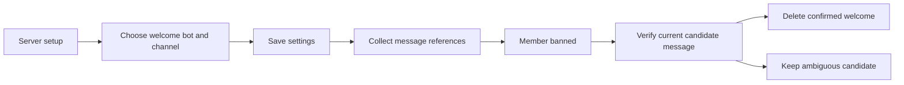

# Welcome cleanup after bans

Delete a banned member's automated welcome message without searching unrelated channels. Cleanup is optional and enabled by default, but requires an administrator to select the welcome bot and channel. The user approved collection followed by verification, and explicitly requested those selections.

## Experience

The existing server setup page adds a cleanup checkbox, a searchable bot picker showing bot names and avatars, and a searchable text-channel picker. Missing selections leave collection inactive. Administrators can clear or change either selection.

## Behavior

Collect image-bearing messages only from the configured bot and channel. Store references, timestamps, and available names of members who joined within two minutes of the message. No model call during collection. References expire using the existing message-retention setting, defaulting to 30 days. The existing retention sweep also removes disabled or reconfigured sources. Store references in Postgres so restarts do not discard them. At ban time, also use the persisted member join date to find candidates when a join-time snapshot was unavailable.

After Discord confirms a ban, fetch candidates again, check their bot/channel against current configuration, and verify identity. An exclusive exact user mention is sufficient. For an image-only card, require a complete member cache at collection time and use the existing structured model client to extract the welcomed name, require high confidence and an exact normalized name match, and reject names shared by other contemporaneous joiners. Timing alone never authorizes deletion. Do not follow instructions in images or message content. Fetch images only from Discord-hosted current attachments/embeds. Cache verification results per message so overlapping join windows do not multiply image calls. Serialize cleanup within each guild, and stop after deleting one confirmed card. Cleanup failures do not affect ban handling.

## Approaches

Server-wide discovery and bot-specific setup instructions were rejected. Automatic observation without configured sources was considered, then replaced by the user's explicit bot/channel selection. Historical scanning and configuration agents are out of scope. Existing messages from before collection started are not covered. Model verification can miss cards, especially after a name change without a captured snapshot; ambiguous cards remain.

## Review corrections

Hosted checks exposed two additional field-count assertions and changed setup screenshots. Review also prompted caching each image result, serializing guild cleanup, respecting the existing retention policy, refusing incomplete-cache image matching, and validating only changed source selections. The bot picker loads known bot IDs directly and uses authenticated name search for other bots instead of enumerating all members. Unavailable saved selections appear as field warnings, including sources supplied through MCP. These corrections retain the approved collection-then-verification design.

Provider failures do not create cached verdicts and stop the current cleanup run. Bot-option member reads are sequential. Mention-based deletion requires visible welcome text or a successful welcome-image check. Changed-source validation uses field-specific generic errors and keeps the existing atomic form-save behavior. The setup copy explains incomplete member information.

Burst-work safeguards inspect at most 20 candidates nearest the join time and perform at most three image checks per ban. Remaining candidates stay unverified. Collection keeps at most 50 join snapshots per card, marking overflow incomplete, and retains at most 50,000 references per server. Welcome pruning runs separately so failure cannot roll back message-context retention or change its count. Bot options load on demand. These internal limits can leave cards during bursts and add no configuration options.

Each image check sends only the first eligible image. Successful deletions log the scoped message, banned member, and verification path. A separate rolling guild quota is deferred: the current design bounds each ban, serializes guild work, and shares verification results across bans without introducing another cost-policy setting.
