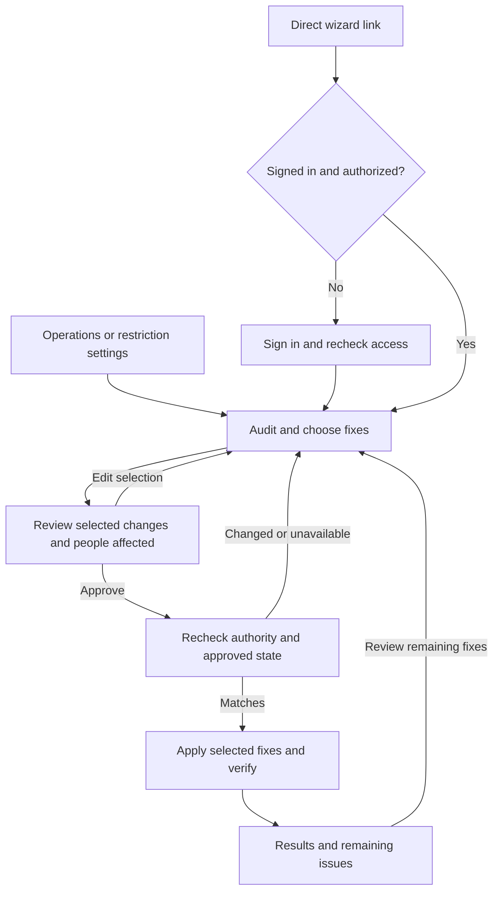

# Restriction audit wizard

Status: approved by the user on 2026-11-17, including the author recommendations below. Production behavior has not been implemented. Implementation-plan review is the next step.

## Review brief

Give server administrators a trustworthy answer to whether Drasil's restriction workflow isolates members, followed by a compact way to review and apply repairs. A healthy setup accounts for role quarantine and effective permissions. It is not defined by the absence of every channel-role allow.

The intended access is the member's own private case thread, with no other community access by default. Administrators may explicitly configure read-only exception channels. Staff safeguards remain: Drasil preserves protected staff roles, but a restricted member who retains excess access is reported as incomplete.

Deliver the corrected assessment and guided repair workflow together. Reuse the shared application actions, moderation request processing, role quarantine, and web foundation. Do not introduce another permission engine for each interface or a general workflow framework.

Design approval authorizes implementation planning. It does not authorize production permission changes or begin implementation.

The approved scope includes one deliberate limit: V1 checks permissions and thread membership without reading message history. It cannot certify what existing messages in a readable recovery parent contain. Report that content scope as unchecked and do not claim verified information isolation, even when permission checks pass. This avoids expanding a permission audit into a content inspection workflow.

| Decision                                                                                                 | Status                                                   |
| -------------------------------------------------------------------------------------------------------- | -------------------------------------------------------- |
| Own private case thread by default; explicit exception channels are read-only                            | Confirmed with the user                                  |
| Preserve staff safeguards; mark actual excess access incomplete                                          | Confirmed                                                |
| Explain exact changes and affected people before applying; broader repairs are permitted when reviewed   | Confirmed                                                |
| Compact selectable rows, closed details, Select all/Clear all, then a bullet-point approval summary      | Confirmed through prototype review                       |
| Original Drasil tree icon, dark-mode presentation, and `#rules (read-only)` text without a badge         | Confirmed visual direction; channel name is illustrative |
| Conservative selection defaults, stop-on-first-failure batches, and no parent-message content inspection | Accepted with design approval                            |

## Why the assessment must change

The existing guild audit reports potential conflicting overwrites without considering whether quarantine removes the corresponding roles. Its warnings can identify useful risks, but the total is not a count of actual restriction failures. It also proposes deny coverage changes that may be hardening rather than repairs for demonstrated access.

The original work deliberately combined channel denies with reversible role quarantine. It separated visibility from posting and preserved staff roles. This design retains those mechanisms while applying the user's stricter current goal: no unrelated visibility or interaction outside configured read-only exceptions.

The assessment must distinguish:

- **Server setup:** whether the configured standard restriction policy leaves access paths for its intended targets.
- **Current cases:** whether already-restricted members actually have the required case access and no excess access now.

A successful configuration write does not establish that current cases were repaired. A saved quarantine policy does not prove that a role removal succeeded.

## Administrator experience

### Choose fixes

The main entry is Restriction audit in Operations, with a link from the restriction settings. Both lead to the same guild-scoped wizard. A direct link requires the existing sign-in and server access checks, then returns to this task.

Start with the current audit, not a separate page of introductory findings. Show:

- A short access-policy line, for example `Own case thread + #rules (read-only)`.
- One flat list of suggested fixes. Each row has a checkbox, a short action title, its scope, and a closed **What changes** disclosure.
- **Select all** and **Clear all** above the list. They select proposals; they never approve or apply them.
- A persistent selected count and **Review changes** action, disabled when nothing is selected.
- A compact **Items still needing attention** disclosure for protected cases, unsupported repairs, and checks that could not finish.

Keep optional hardening distinct from confirmed excess access. Do not lead with hundreds of overwrite warnings or repeated status badges. Use stable channel and role identities internally and their readable names in copy. Do not truncate necessary permission effects or affected-member disclosures.

Opening a row explains the before/after permission or policy change, why it is proposed, and who gains or loses access. Category changes disclose inherited effects on synced children. Changes affecting ordinary members must say so. Report exact affected-person counts only when effective access was evaluated for that population; role-holder counts alone must be labeled as such.

Prefer fixing a quarantine exemption over removing ordinary members' channel access when it achieves the same isolation safely. For example, including a removable non-staff role in quarantine can preserve normal access while removing it from restricted members. Explain both the future policy change and any separate current-member role removal.

### Review and approve

The next screen contains a short bullet list of only the selected fixes. Each bullet includes the concrete action, the necessary permission or policy effect, and affected scope. A grouped fix may contain multiple effects, such as changing quarantine policy and removing a saved role from an existing case; approval must cover both explicitly.

Keep the existing access-effect confirmation pattern. Applying requires an explicit approval control and action. Editing the selection, using bulk selection, refreshing the audit, or changing material effects clears approval. Returning to selection preserves choices, not approval.

Do not restore the removed **These changes cannot** block to this screen. Remaining issues belong in the attention disclosure and results. This does not permit a verified result when a required check failed.

### Apply and show results

The primary action queues the approved plan using Drasil's existing request lifecycle. Prevent duplicate submission and show progress while it runs. Keep the request identity available so reloads can recover the result.

Results lead with what happened: applied fixes, failed or unverified effects, and fixes not attempted. Then show the remaining restriction problems. Applying selected fixes is not the same as verifying full isolation. A protected staff case or unavailable membership check must remain visible without turning the result into a long debugging report.

### Journey: review and apply restriction fixes

Operations and settings keep their normal access checks. Signing in never grants missing server authority. A materially changed plan returns for fresh approval; an unavailable read explains what could not be checked.

## Assessment rules

| Result     | Meaning                                                                                                                            |
| ---------- | ---------------------------------------------------------------------------------------------------------------------------------- |
| Verified   | Required checks completed and the assessed access matches the policy, with scope and time stated.                                  |
| Incomplete | Confirmed access exceeds policy, required case access is broken, or a known platform/configuration limitation prevents the target. |
| Unverified | A required read or coverage check could not complete.                                                                              |

Store coverage separately from findings. Confirmed excess access remains incomplete even if another check is unavailable. If there is no confirmed failure but required coverage is missing, the overall result is unverified. Optional hardening does not invalidate an otherwise verified assessment.

### Model the configured policy

Reuse the same role classification as enforcement: quarantine mode, configured exemptions, automatic manual-intake exclusions, managed roles, staff privileges, and role hierarchy. Share these rules rather than copying a new approximation into the audit.

- A channel allow on a role that standard quarantine removes is a conditional risk handled by that policy, not an unconditional broken-setup warning.
- An allow on a non-staff role that standard quarantine preserves can identify a prospective setup gap. Say which retained-role condition causes access; do not invent a current affected-member count.
- The mere existence of staff roles does not make the server setup fail. Their preservation is an explicit policy limit. For actual restricted members, retained staff access beyond policy makes that case incomplete.
- Quarantine off or audit-only must be assessed as configured. Suggest enabling removal when needed, but never assume it already happens or change policy during an audit.

Use Discord's effective permission order, including guild ownership, Administrator, role allows/denies, member overwrites, and implicit View Channel restrictions. Check capabilities by channel type, including text, voice, forum/media, and thread behavior. An isolated permission bit without effective visibility does not establish a posting leak.

For current cases, inspect live membership, assigned case role, retained roles, and applicable member overwrites. Do not substitute stored role state, a bot's own visibility, or a hypothetical member for a checked target. Preserve active-case enforcement against newly acquired removable roles.

### Case access and platform limits

Verify the member can read and reply in the correct private case thread. Check public and private sibling threads and relevant archived threads, membership, thread-management privileges, parent permissions, and thread lock/archive state. Account for the existing case lifecycle; archived does not automatically mean inaccessible or unable to reopen.

Discord requires parent View Channel access to reach a thread. Use a dedicated recovery parent with minimal necessary access and no unrelated content or public discussion threads. Its technical visibility must be explained as part of case access, not silently counted as an ordinary exception or hidden from the report. If the parent exposes unrelated material, mark the affected scope incomplete. This release does not replace the existing private-thread case architecture.

Permission and thread metadata do not prove that existing parent messages contain no unrelated material. V1 does not scan those messages or treat an administrator's dedicated-parent designation as content proof. It can report **Permissions verified** for completed permission/membership checks while explicitly leaving **Recovery-parent content unchecked**. Any broader claim that the member can see only their own case information remains unverified. If unrelated content exposure is already known, report incomplete rather than merely unchecked. Content inspection or a separately proven clean recovery-parent workflow is future work, not an implicit requirement for this release.

Exception channels are explicit and read-only. Do not automatically allow every rules, report, welcome, or recovery-looking channel by name. Migrate existing explicit exceptions without silently dropping access; audit any existing automatic exceptions against the stricter policy and propose changes for review. Exception categories inherited from existing settings must be expanded to show their affected channels; V1 adds channel exceptions, not new category-wide exception controls.

Check and deny applicable write/interaction permissions in an exception, including thread replies and creation, rather than only Send Messages. Discord can permit joining an existing reaction despite denying Add Reactions. Report such a known limitation without claiming strict no-interaction verification. Removing the exception is a possible reviewed remedy; do not silently relax the access policy.

Guild restriction cannot prevent mutual-server direct messages. The audit's scope is server access, not account-wide containment.

### Coverage and grouping

Audit categories and independently configured children, and account for synced inheritance. Group identical inherited effects rather than generating duplicate rows for every synced child. Enumerate relevant current cases and required permission/thread metadata in bounded pages. No message-history scan is required for a permission audit.

Do not present a sample as a complete audit. Show checked and unchecked scopes, pagination completion, and the last successful observation time. Large or interrupted scans use the existing background/request facilities; reaching a work budget produces partial coverage, not a green result.

Handle missing and obfuscated Discord channel metadata explicitly. A channel that the bot cannot fully inspect is not proof that restricted members cannot access it. Do not automatically elevate bot permissions to complete an audit.

## Repair plan and execution

### Supported repairs

The plan can include category/channel case-role overwrites, explicit exception permissions, necessary unsync operations, safe case-role permission corrections, and supported quarantine policy changes. Broader role/channel permission changes are allowed when their access effects are stated and explicitly approved.

Keep ordinary membership access unchanged when a narrower repair works. Do not bulk strip every role allow to clear warnings. Case-role grant safety checks remain at their existing enforcement boundary.

Applying quarantine to existing cases is a separate disclosed effect from updating future policy. Snapshot eligible removals before acting, preserve prior snapshots, and use the existing safe restoration rules for verified or closed-without-action cases. Do not promise unconditional restoration; deleted, newly privileged, unmanageable, policy-managed, banned, or departed-member cases retain existing handling. Do not remove protected staff roles through this wizard.

The plan also lists required manual work. Ownership, unmanageable roles, protected staff decisions, unavailable resources, and unsupported repairs cannot be hidden or treated as successful writes. Automatic member-specific overwrite rewriting and its later restoration are deferred; report the exact required manual correction instead. Do not automatically migrate recovery channels or thread memberships in V1.

### Proposed default selections

The prototype's prechecks are illustrative. For production, default-check only narrow case-role permission corrections that enforce the approved access policy and have no access effect on ordinary members. Leave role removals, quarantine policy changes, unsync operations, broader role/member changes, and optional hardening unchecked. Unavailable or manual repairs cannot be selected for automatic application.

Select all includes all selectable proposals, including optional and broader ones; it is never approval. Any explicit dependencies are disclosed as one inseparable fix or require selecting their prerequisite. Do not silently expand the approved set. Keep this limited to the few supported repair types, not a generic dependency engine.

### Approval and stale state

Audit is read-only. Preserve the existing owner/Administrator boundary for lockdown configuration and execution, the separate web entry checks, and MCP consent/delegation restrictions. Recheck actor presence and authority on audit, plan admission, and execution. Bot permissions and role hierarchy are checked per effect.

Bind approval to the actor, guild, audit/plan revision, selected fix identities, case/member identities, exact material before/after state, and disclosed affected scope. Store the accepted plan with the existing durable execution request. Client-submitted labels, counts, booleans, or a former coarse Apply Lockdown approval are not authority for additional changes.

Before the first write, refresh all material selected-plan facts. Changed target permissions, relevant policy, membership, hierarchy, or affected scope requires a new review. Immediately before each write, recheck its preconditions. Cosmetic renames or unrelated settings should not force approval again unless they change the material effect.

Discord does not provide a transaction across these writes. A race after preflight remains possible; preserve unrelated overwrite bits and verify the actual result. Never claim atomic execution or overwrite a concurrent administrator's unrelated changes.

### Proposed failure behavior

Stop the batch at the first write failure, lost precondition, or uncertain outcome. Mark later fixes not attempted and read back attempted effects where possible. This deliberately follows Drasil's existing fail-fast behavior instead of adding independent/dependent execution scheduling.

Record each attempted effect and its observed outcome through the existing durable request/result machinery. A timeout is not a proven failure. On restart or revisit, reconcile unknown effects before another mutation. Do not replay a completed role removal or replace its original restoration snapshot.

There is no automatic rollback or retry loop. Successful protective changes remain in place. To continue, audit the resulting state, propose only necessary remaining effects, and obtain fresh approval. Explain that a partially applied fix may leave future policy changed while an existing case still needs repair.

Fresh verification covers the changed permissions and relevant access, with separate server-setup and current-case results. A successful API response or finished batch alone cannot produce Verified.

## Shared implementation scope

The wizard lives in the existing web workspace and uses Foundation components, the original tree asset, dark-mode styling, and existing theme preferences. The reviewed presentation is dark; do not force a new theme preference on the rest of Drasil. Keep responsive rows, visible focus, native checkbox/disclosure semantics, and a footer that does not obscure content.

One shared assessment/plan/execution contract serves web, Discord, and MCP. The web supplies the full wizard; Discord and MCP expose the same findings, coverage, selected effects, approval binding, and results through their existing interaction models. No new chat-style wizard is required. Update existing audit/apply entry points so the old coarse apply cannot bypass selected-plan approval. Preserve shipped command/tool identifiers where needed; document any actual compatibility requirement rather than adding speculative aliases.

Work reaches the permission services and role classification, shared application operations/reports/commands, authorization and confirmation, durable request dispatch/results, web Operations/settings entry points, Discord lockdown commands, MCP operation delivery, restoration snapshots, and relevant documentation. Choose exact types, routes, storage extensions, paging budgets, and component boundaries during implementation planning. Reuse existing request storage; add only the persistence needed for selected-plan facts and effect receipts.

This assessment must not reintroduce the removed setup-readiness downgrade or prevent configured automatic cases/kicks from being attempted. Restriction quality is reported honestly alongside moderation outcomes; it is not a new blanket moderation gate. Existing compromised-account safety checks must use the corrected shared semantics without weakening their containment requirements.

## Approaches and scope boundaries

| Approach                                                                    | Tradeoff                                                                  | Decision                                                   |
| --------------------------------------------------------------------------- | ------------------------------------------------------------------------- | ---------------------------------------------------------- |
| Correct only the existing audit, add repairs later                          | Smaller first delivery, but administrators still perform repairs manually | Considered; not the selected complete-workflow direction   |
| Shared policy-aware assessment with compact web review and approved repairs | Larger cohesive delivery; avoids contradictory interface assessments      | Selected direction through discussion and prototype review |
| Standalone replacement permission/workflow platform                         | Adds duplicate rules, migration, and maintenance                          | Rejected as unnecessary                                    |

Non-goals include removing staff privileges automatically, general Discord permission administration, kicks/bans or case closure from the wizard, message deletion, continuous drift monitoring, unattended repair, global rollback, a new queue system, and automatically rewriting member-specific overwrites. The wizard may diagnose those boundaries and link to existing operator workflows.

## Acceptance evidence

- A role deny plus an allow on a role removed by quarantine does not create an unconditional broken-setup warning. Quarantine off, exemptions, and removal failures produce the appropriate distinct findings.
- Actual restricted staff access is incomplete; staff roles are preserved. Unrelated staff-role existence is not a server failure.
- Effective member overrides, Administrator/owner privileges, synced and unsynced children, missing metadata, non-text channels, private/archived thread membership, broken case access, and read-only exception interactions are covered. A passing permission check never certifies unread recovery-parent content.
- Inherited effects are grouped; prospective conditions and actual member counts are not confused. Incomplete coverage never produces Verified.
- Selection defaults follow the stated policy. Bulk selection updates the bullet summary and clears approval. No selection cannot submit. Only the selected, approved effects execute.
- Cross-guild/actor/plan substitution, authority revocation, stale permissions/settings/membership, relevant concurrent changes, and an old coarse apply approval cannot authorize writes.
- A mid-batch failure stops later work. Timeouts and crashes are reconciled without duplicate effects or snapshot loss. Remaining work requires a fresh plan and approval.
- Server setup repairs and existing-member repairs have separate outcomes. A green write receipt cannot hide incomplete or unverified restriction.
- Keyboard, narrow-screen, dark-mode, and theme-preference checks preserve the original icon, compact list, disclosures, selection controls, bullet review, and readable results.
- A separately authorized controlled Discord acceptance proves case access, isolation, exceptions, role restoration, and failure reporting. Unit tests, screenshots, and metadata calculations alone are not live member-session proof.

Keep tests small and behavioral. Reuse in-memory factories and real-database coverage for races and persistence. Do not copy large fixture graphs or snapshot every wording variation.

## Evidence and references

- Source baseline: `f7f05b79016ef34ff3265c3d4b34a4df603d6431` on `main`, refreshed 2026-11-17. This is a docs-only design checkpoint.
- Existing behavior: `src/services/CaseRoleLockdownService.ts`, `src/services/RoleQuarantineService.ts`, `src/utils/roleQuarantineSettings.ts`, `packages/application/src/operations/`, `src/application/adapters/operations.ts`, `src/application/operationsDispatch.ts`, and `apps/web/components/operations/OperationsView.tsx`.
- UI foundation: `apps/web/components/workspace/Foundation.tsx`, `Foundation.module.css`, and `apps/web/public/brand/drasil-tree.png`.
- Original [bypass assessment issue #143](https://github.com/BITRATE-Labs/drasil/issues/143), [quarantine issue #144](https://github.com/BITRATE-Labs/drasil/issues/144), and its [recorded direction decisions](https://github.com/BITRATE-Labs/drasil/issues/144#issuecomment-4703024323). The stricter visibility policy in this design supersedes their earlier visibility allowance.
- [Discord permission rules](https://docs.discord.com/developers/topics/permissions) and [reaction creation requirements](https://docs.discord.com/developers/resources/message#create-reaction). Thread parent visibility and existing-reaction limits were checked against official documentation on 2026-11-17. Discord channel obfuscation is another reason to track inspection coverage explicitly.
- Mobbin research, 2026-11-17: query `Reviewing and applying bulk changes in an admin dashboard`, web, limit two. [Twenty's Updating records flow](https://mobbin.com/flows/5970df17-fd43-4b05-8031-b11b1db98089?tab=screens), all seven returned positions inspected from downloaded originals. Positions 1–2 show flat bulk selection, 3–5 disclose editing separately, 6 confirms, and 7 returns to the updated list. This supports compact selection and separate approval; it does not prove failure recovery or permission safety. Retool's App preview was inspected only through three inline previews and was not the primary reference.
- Reviewed prototype: `restriction-audit-v11.html`, fictional and disconnected from Discord. It establishes visual and interaction direction, not the backend plan model, selection policy, real access counts, or live acceptance. The standalone prototype is not production code to copy into the application.
- Prior production investigation found potential overwrite conflicts and missing explicit denies; a ten-member metadata sample supported isolation for those members. That dated sample was not a full-server certification, and private-thread membership reads were refused. No private server/member identifiers or historical warning totals are acceptance criteria for this feature.
